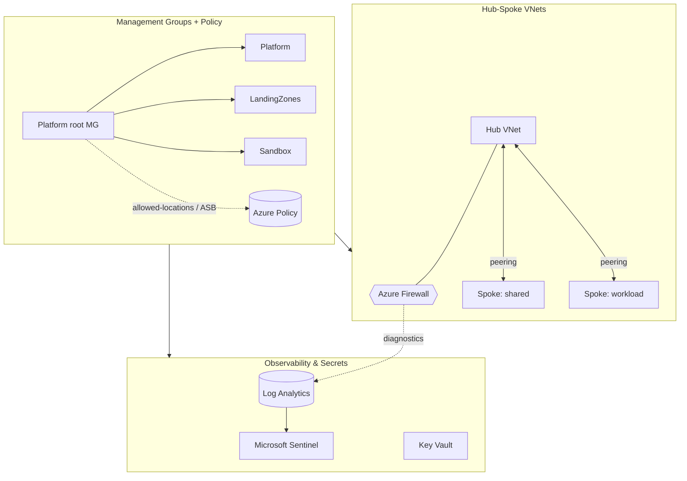

# Terraform Azure Landing Zone

[](LICENSE)
[](https://github.com/abhisheksawant52/terraform-azure-landing-zone/actions/workflows/ci.yml)
[](https://www.terraform.io/)
[](https://registry.terraform.io/providers/hashicorp/azurerm/latest)

A modular **Azure landing zone** built with Terraform, aligned to the Cloud
Adoption Framework: a management group hierarchy with policy guardrails, a
hub-and-spoke network anchored by Azure Firewall, and centralized observability
via Log Analytics.

## Overview

Enterprise Azure adoption starts with governance and connectivity, not
workloads. This project provisions the platform layer: the management group
tree, Azure Policy assignments (allowed regions, Azure Security Benchmark), the
hub VNet with Azure Firewall for centralized egress, spoke VNets peered to the
hub, and a Log Analytics workspace wired to Microsoft Sentinel.

It targets platform teams establishing an Azure tenant or bringing an existing
subscription estate under consistent governance. The root module composes three
submodules — `management-groups`, `networking`, and `security` — parameterized
per environment (`dev`, `prod`).

## Architecture



Components:

- **management-groups** — child management groups under the platform root, a
  custom allowed-locations policy definition + assignment, and the built-in
  Azure Security Benchmark initiative.
- **networking** — hub VNet with `AzureFirewallSubnet` + Azure Firewall, spoke
  VNets, bidirectional peering, and firewall diagnostics to Log Analytics.
- **security** — Log Analytics workspace, Microsoft Sentinel solution, and a
  purge-protected, RBAC-enabled Key Vault.

## Features

- CAF-aligned management group hierarchy created from a simple list.
- Preventive governance: region restriction and Azure Security Benchmark.
- Hub-and-spoke connectivity with centralized Azure Firewall egress.
- Centralized logging with Sentinel-ready Log Analytics.
- Diagnostic settings streaming firewall logs and metrics to Log Analytics.
- Environment isolation with per-environment tfvars and remote state backends.

## Tech Stack

Terraform >= 1.5 · azurerm ~> 3.100 · azuread ~> 2.47 · Azure Management Groups ·
Azure Policy · Azure Firewall · Log Analytics · Microsoft Sentinel · Key Vault ·
GitHub Actions · TFLint

## Getting Started

### Prerequisites

- Terraform >= 1.5
- Azure CLI authenticated (`az login`) with permissions at the tenant /
  management group scope
- A storage account + container for remote state (see `environments/*/backend.hcl`)

### Configure

```bash
cp terraform.tfvars.example terraform.tfvars
# edit management groups, address spaces, and allowed locations
```

### Initialize & plan

```bash
terraform init -backend-config=environments/dev/backend.hcl
make fmt-check
make validate
make plan ENV=dev
```

## Project Structure

```
.
├── main.tf                      # composes the three submodules
├── variables.tf
├── outputs.tf
├── versions.tf                  # required_providers + backend (commented)
├── providers.tf                 # azurerm + azuread providers
├── terraform.tfvars.example
├── modules/
│   ├── management-groups/       # MG tree, Azure Policy
│   ├── networking/              # hub/spoke VNets, Azure Firewall, peering
│   └── security/                # Log Analytics, Sentinel, Key Vault
├── environments/
│   ├── dev/{terraform.tfvars,backend.hcl}
│   └── prod/{terraform.tfvars,backend.hcl}
└── .github/workflows/ci.yml     # fmt / validate / tflint
```

## Configuration

| Variable                   | Default              | Description                              |
| -------------------------- | -------------------- | ---------------------------------------- |
| `location`                 | `westeurope`         | Primary Azure region.                    |
| `environment`              | `dev`                | Environment name.                        |
| `org_name`                 | `acme`               | Short org identifier used in naming.     |
| `root_management_group_id` | `acme-platform`      | Parent management group ID.              |
| `management_groups`        | `[Platform, ...]`    | Child management groups to create.       |
| `allowed_locations`        | `[westeurope, ...]`  | Regions allowed by policy.               |
| `hub_address_space`        | `[10.0.0.0/16]`      | Hub VNet address space.                  |
| `spoke_address_spaces`     | `{shared, workload}` | Spoke VNet address spaces.               |
| `log_retention_days`       | `90`                 | Log Analytics retention.                 |

## Deployment

Each environment has its own state backend and variables:

```bash
terraform init -backend-config=environments/prod/backend.hcl
terraform plan -var-file=environments/prod/terraform.tfvars
```

## Contributing

Contributions are welcome — see [CONTRIBUTING.md](CONTRIBUTING.md) and our
[Code of Conduct](CODE_OF_CONDUCT.md).

## Security

Please report vulnerabilities as described in [SECURITY.md](SECURITY.md).

## License

Released under the [MIT License](LICENSE).
